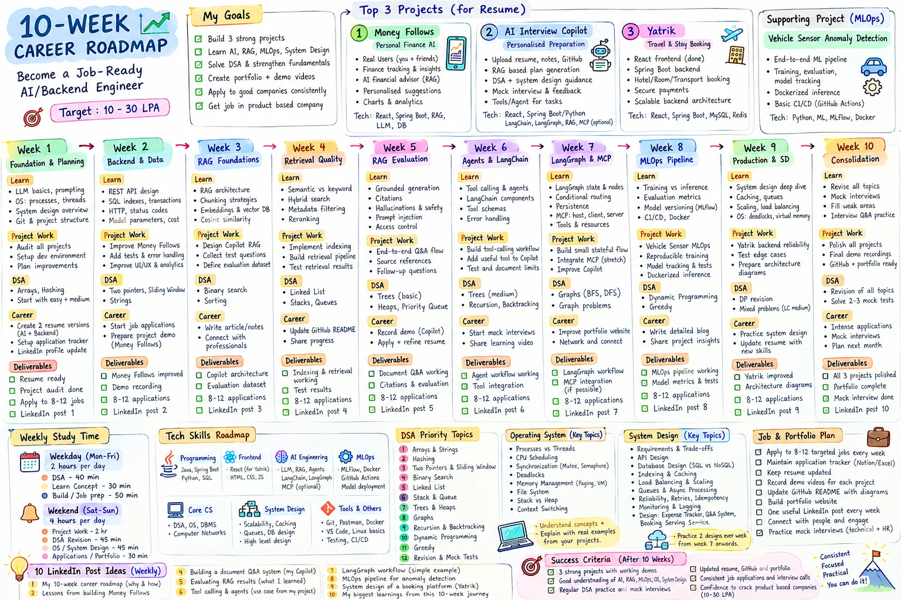

# 10-Week Career Transition Roadmap

**Goal:** become a job-ready **AI / Backend Engineer** and land a role at a product-based company.
**Target:** 10–30 LPA · **Duration:** 10 weeks (70 days) · **Budget:** 18 hours/week (≈180 hours)

> Weekly outcomes over daily rigidity. Build, test, explain, publish and apply.



---

## Contents

1. [Positioning and goals](#1-positioning-and-goals)
2. [Weekly time budget](#2-weekly-time-budget)
3. [Project strategy](#3-project-strategy)
4. [The 10-week journey](#4-the-10-week-journey)
5. [Weekly repeatables](#5-weekly-repeatables)
6. [DSA plan](#6-dsa-plan)
7. [OS and system design](#7-os-and-system-design)
8. [LinkedIn plan](#8-linkedin-plan)
9. [Weekly review](#9-weekly-review)
10. [Success criteria](#10-success-criteria)
11. [Progress tracker](#11-progress-tracker)

---

## 1. Positioning and goals

**Positioning:** a backend-focused engineer with hands-on GenAI and full-stack experience.
**Primary focus:** RAG, AI engineering, agents, LangChain / LangGraph, MCP and practical MLOps.

Resume variants:

- **Backend + AI CV:** Spring Boot, SQL, APIs and reliability, plus RAG and agents
- **Full-stack + AI CV:** React and Spring Boot end to end, plus RAG and agents

Goals:

- [ ] Build 3 strong projects
- [ ] Learn AI, RAG, MLOps and system design
- [ ] Solve DSA and strengthen fundamentals
- [ ] Create a portfolio and demo videos
- [ ] Apply to good companies consistently
- [ ] Get a job in a product-based company

**The working loop:** watch a focused lesson → write 3–5 notes → implement or solve → explain it aloud → turn it into an interview answer or portfolio artifact.

---

## 2. Weekly time budget

| Block | Time | What to do |
|---|---|---|
| DSA in Java | 40 min × 5 weekdays | One focused problem or re-solve; explain complexity and edge cases |
| Concept learning | 30 min × 5 weekdays | This week's topic; 3–5 notes and one interview answer |
| Build / career | 50 min × 5 weekdays | Project work, tests, applications, resume or interview practice |
| Weekend project | 2 h × Sat, Sun | Implement and test the weekly milestone |
| Weekend DSA | 45 min × Sat, Sun | Revision or one timed attempt |
| Weekend interview | 45 min × Sat, Sun | OS, system design or AI interview practice |
| Weekend career | 30 min × Sat, Sun | Applications, portfolio, demo or LinkedIn post |

When an interview or urgent work deadline lands, reduce the week's scope. Do not add hours or sacrifice sleep.

---

## 3. Project strategy

Three flagship projects plus one supporting project. No new large project until these milestones are done.

### 1. Money Follows: personal finance AI (real-world product)
`React` `Spring Boot` `RAG` `LLM` `DB`
- Improve reliability, usability and tests based on real usage (you + friends)
- Document core workflows; add a clear README and architecture overview
- Record a short demo; add AI only where it solves a real user need

### 2. AI Interview Copilot: personalised preparation (flagship AI)
`React` `Spring Boot / Python` `LangChain` `LangGraph` `RAG` `MCP (optional)`
- Ingest resumes, notes and GitHub; chunking, embeddings and retrieval
- Grounded answers with source citations; follow-up questions
- Test retrieval quality, missing evidence, prompt injection and per-user document access
- One bounded tool-calling feature and a small stateful LangGraph workflow

### 3. Yatrik: travel and stay booking (full-stack)
`React` `Spring Boot` `PostgreSQL` `Redis`
- React frontend (done) alongside the Spring Boot backend
- Booking transactions and double-booking protection; integration tests; useful indexes
- API docs, architecture diagram and a full booking-flow demo

### Supporting: Vehicle Sensor Anomaly Detection (MLOps)
`Python` `ML` `MLflow` `Docker` `GitHub Actions`
- Reproducible training and evaluation, saved model and metrics
- Experiment tracking, automated tests, Dockerized inference API, basic CI/CD

> Use work experience (Gurukul AI Teacher, ERP) in interviews, but never expose confidential company data, code or architecture.

---

## 4. The 10-week journey

Each week has a learning target, a project deliverable and an end-of-week proof.

| Week | Theme | Learn | Build | DSA | End-of-week proof |
|---|---|---|---|---|---|
| 1 | Foundation & Planning | LLM basics, tokens, prompting · OS process vs thread · system design overview · Git | Audit all four projects, set up the dev environment, plan improvements | Arrays, hashing | Project audit + two resume variants + master DSA tracker |
| 2 | Backend & Data | REST design · HTTP and status codes · SQL indexes and transactions · model parameters, latency, token cost | Money Follows: reliability, tests, error handling, UI/UX, README | Two pointers, sliding window, strings | Tested improvements + README + demo v1 |
| 3 | RAG Foundations | RAG architecture · ingestion · chunking · embeddings and vector DBs · cosine similarity | Design Copilot RAG; build an evaluation question set | Binary search, sorting | Architecture diagram + evaluation set |
| 4 | Retrieval Quality | Semantic vs keyword · hybrid search · metadata filtering · top-k and reranking | Document indexing and retrieval pipeline; keep failure examples | Linked list, stacks, queues | Working retrieval pipeline + test examples |
| 5 | RAG Evaluation | Grounded generation · citations · hallucinations · prompt injection · access control | End-to-end Q&A with sources and follow-ups; test bad retrieval and data isolation | Trees (basic), heaps | Copilot RAG demo v1 |
| 6 | Agents & LangChain | Tool calling · agent vs fixed workflow · LangChain components · tool schemas · error handling | One bounded tool-calling workflow in Copilot; document limits | Trees (medium), recursion, backtracking | Working tool-calling feature + notes |
| 7 | LangGraph & MCP | LangGraph state, nodes, edges, routing, persistence · MCP host/client/server | Small stateful workflow; MCP example only if on track | Graphs (BFS, DFS) | Workflow diagram + example (MCP is stretch) |
| 8 | MLOps Pipeline | Data validation · training vs inference · metrics · versioning (MLflow) · CI/CD · Docker | Vehicle Sensor: reproducible training, tracking, tests, Dockerized inference | DP, greedy | Repeatable train → evaluate → serve pipeline |
| 9 | Production & System Design | Logging, monitoring, caching, retries, idempotency, scaling · OS: deadlocks, virtual memory | Yatrik reliability and tests; design document Q&A and booking service aloud | DP revision, mixed mediums | Yatrik update + two design walkthroughs |
| 10 | Consolidation | Revise weak areas across all topics | Polish projects, final demos, GitHub + portfolio | Re-solve mistakes, 2–3 timed mocks | Portfolio pages + demo links + progress review |

Career track per week: resumes and LinkedIn profile (1) → start applying, Money Follows demo (2) → article and networking (3) → GitHub README, share progress (4) → Copilot demo, refine resume (5) → mock interviews (6) → portfolio website (7) → detailed blog (8) → system design practice, resume update (9) → intense applications and plan next month (10).

---

## 5. Weekly repeatables

- **DSA:** 5–7 meaningful problems or re-solves, including one timed attempt
- **Applications:** 8–12 relevant applications
- **System design / OS:** one short note, diagram or spoken explanation (not just a watched video)
- **Portfolio:** one visible improvement: a feature, test evidence, README, diagram or demo
- **LinkedIn:** one useful post about something actually built or learned

---

## 6. DSA plan

One master tracker merges three sheets and removes duplicates:

| Sheet | Problems | Structure |
|---|---|---|
| Core | 70 | Levels: warmup → arrays & strings → hashmap / sliding window → stack & queue → binary search → linked list → trees → DP, greedy, prefix |
| Infosys SP/DSE | 40 | Block 1 must-win → Block 2 high-probability medium → Block 3 SP decider → Block 4 safety net |
| Amazon prep | 45 | Priority P0 / P1 / P2 with likelihood, "what to do" and dependencies |
| **Master (deduplicated)** | **88** | Ranked by number of sheets, then Amazon priority, then Infosys block |

Full list with LeetCode / GFG links and reference complexities: **[docs/dsa-master-list.md](docs/dsa-master-list.md)**

Pattern priority:

1. Foundations: reverse array, sorted check, second largest, Two Sum, frequency counting
2. Arrays & hashing: Kadane, Group Anagrams, Product Except Self, Subarray Sum K
3. Sliding window: Longest Substring Without Repeating Characters; fixed and variable windows
4. Binary search: standard, rotated array, answer space (Koko)
5. Stacks & intervals: Valid Parentheses, monotonic stack, Merge Intervals
6. Linked lists: reverse, cycle detection, merge
7. Trees & graphs: traversals, level order, diameter, LCA, Number of Islands, Course Schedule
8. Stretch: Top K, Kth Largest, basic DP, House Robber, shortest path

Per problem, track: solved alone or with a hint, time and space complexity in your own words, edge cases, and re-solve dates. Re-solve after 1, 3, 7, 14 and 30 days.

---

## 7. OS and system design

**OS checklist**
- [ ] Process vs thread, context switching, stack vs heap
- [ ] Race conditions, mutexes, semaphores, synchronization
- [ ] Deadlocks and the four necessary conditions
- [ ] CPU scheduling; virtual memory, paging and page faults

**System design framework:** requirements → APIs / data model → high-level architecture → bottlenecks → reliability / security → trade-offs

- Foundations: REST, SQL vs NoSQL, indexing, transactions, caching, authentication
- Reliability: retries, idempotency, observability, concurrency, failure handling
- Practice designs: document Q&A / RAG system · expense tracker · booking service

---

## 8. LinkedIn plan

| Week | Post |
|---|---|
| 1 | Money Follows: what building for real users teaches you |
| 2 | Reliable APIs: validation, useful errors and robust request handling |
| 3 | RAG architecture: how documents become searchable evidence |
| 4 | Retrieval quality: good vs poor retrieved passages |
| 5 | Copilot RAG demo: grounded answers with citations |
| 6 | Tool calling: a bounded workflow and its failure handling |
| 7 | LangGraph / MCP: a small workflow and a lesson learned |
| 8 | MLOps: training → evaluation → serving pipeline |
| 9 | Yatrik: preventing double booking with transactions and concurrency control |
| 10 | Ten-week retrospective: what shipped, what was measured, what was learned |

Only claim features that are working and tested.

---

## 9. Weekly review

Every Sunday:

1. Which concepts can I explain without notes?
2. What did I implement, test or publish?
3. Which DSA problems did I solve alone, and which need a re-solve?
4. How many applications did I send? Which follow-ups are due?
5. What is the single most important unfinished task for next week?

---

## 10. Success criteria

After 10 weeks:

- [ ] 3 strong projects with working demos
- [ ] Solid understanding of AI, RAG, MLOps, OS and system design
- [ ] Regular DSA practice and mock interviews
- [ ] Updated resume, GitHub and portfolio
- [ ] Consistent applications and interview calls
- [ ] Confidence to crack product-based companies (10–30 LPA)

Success means stronger project evidence, a repeatable interview routine, a polished portfolio and consistent applications. It does not mean a guaranteed offer in week 10.

---

## 11. Progress tracker

Daily tracking happens in **Career Forge**, a gamified tracker for this plan: weekly missions with XP and stars, 88 DSA problems with solve counters and LeetCode links, project logs and an application tracker.

- **Main tracker:** a private hosted link; progress syncs between laptops and phone.
- **Offline copy:** [`tracker/index.html`](tracker/index.html), a single file that opens in any browser and saves locally. It can also sync through a private GitHub Gist (Settings → Sync across devices) if it is ever hosted.

```
.
├── README.md                 ← this roadmap
├── docs/
│   ├── roadmap-chart.webp    ← one-page roadmap chart
│   └── dsa-master-list.md    ← 88 ranked problems with links
└── tracker/
    └── index.html            ← Career Forge (offline copy)
```
